# Deploying a Highly Available Web Application with Docker and Nginx Load Balancer on Azure Linux VMs

Comprehensive documentation detailing the architecture, provisioning, and configuration of a containerized high-availability web application on Azure Linux Virtual Machines. The deployment utilizes custom Docker containers hosting Nginx web services on backend nodes (`webserver1` and `webserver2`), fronted by a dedicated Nginx reverse proxy load balancer instance (`loadbalancer`).

---

## 1. Architecture & Provisioned Resources

### Core Infrastructure Topology

| Resource Type | Resource Name | Specification / Tier | Region / Location |
| :--- | :--- | :--- | :--- |
| **Load Balancer VM** | `loadbalancer` | Standard B2s, Ubuntu 24.04 LTS | East US |
| **Backend Web Server 1** | `webserver1` | Standard B2s, Ubuntu 24.04 LTS | East US |
| **Backend Web Server 2** | `webserver2` | Standard B2s, Ubuntu 24.04 LTS | East US |
| **Load Balancer Public IP** | `loadbalancer-ip` | Static Standard IPv4 (`20.25.70.223`) | East US |
| **Web Server 1 Public IP** | `webserver1-ip` | Static Standard IPv4 (`172.173.221.48`) | East US |
| **Web Server 2 Public IP** | `webserver2-ip` | Static Standard IPv4 (`172.173.243.118`) | East US |
| **Virtual Networks** | `vnet-eastus-1`, `vnet-eastus-2`, `vnet-eastus-3` | Address Space: `172.16.0.0/16` | East US |

---

### Provisioned Environment Validation

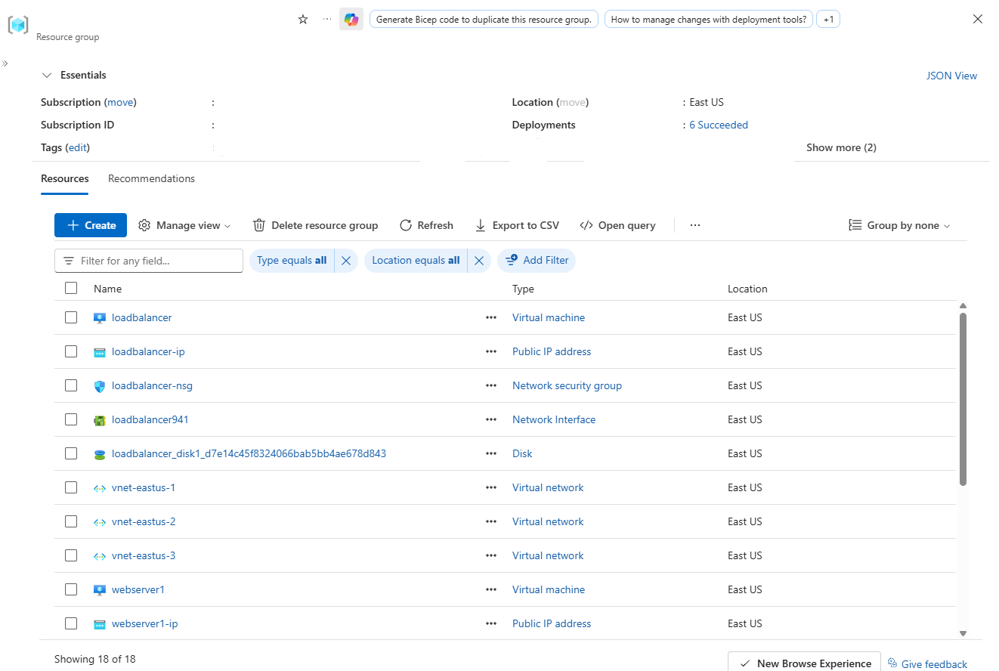

*Resource group overview (part 1) confirming successful deployment of the loadbalancer virtual machine, public IP addresses, network security groups, and virtual networks.*

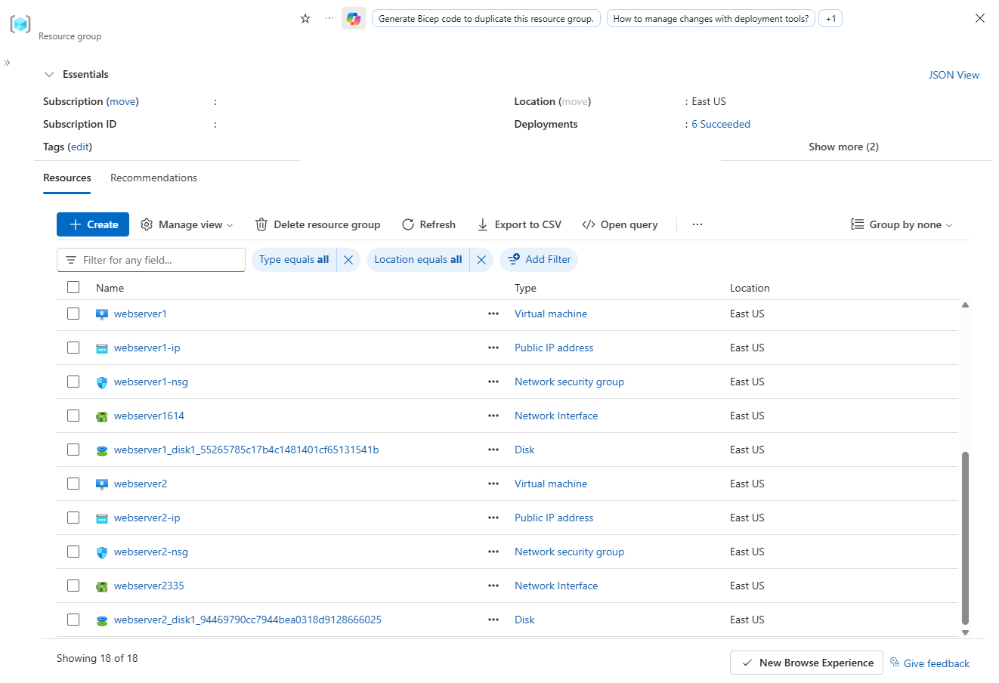

*Resource group overview (part 2) confirming successful deployment of webserver1 and webserver2 virtual machines, associated disks, and network interfaces.*

---

## 2. Step-by-Step Implementation

### Step 1: Inspect Compute and Network Sizing

Verified runtime status, operating system image specifications, and primary IP configurations for all three virtual machines in the Azure Portal.

* **Load Balancer Node (`loadbalancer`):** Private IP `172.16.0.4`, Public IP `20.25.70.223`
* **Backend Node 1 (`webserver1`):** Private IP `172.16.0.4`, Public IP `172.173.221.48`
* **Backend Node 2 (`webserver2`):** Private IP `172.16.0.4`, Public IP `172.173.243.118`

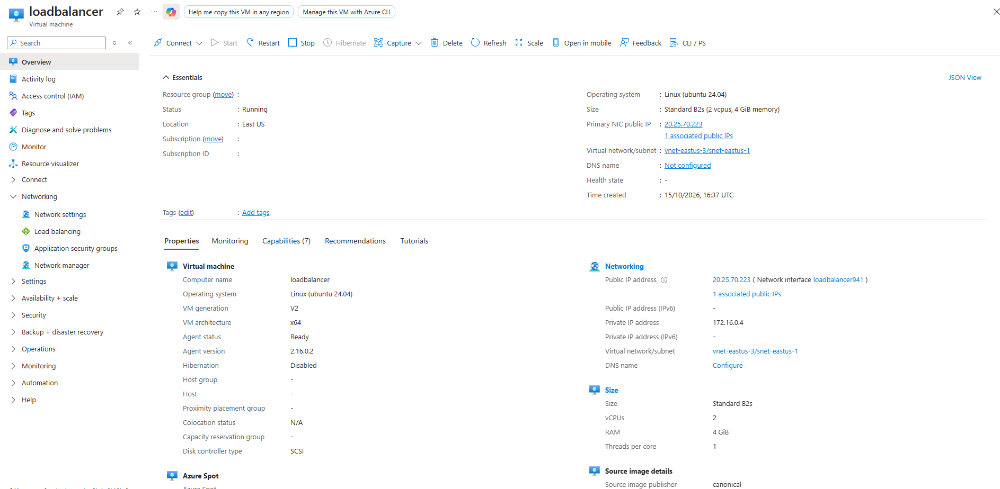

*Inspecting properties and public/private IP addresses for the loadbalancer VM.*

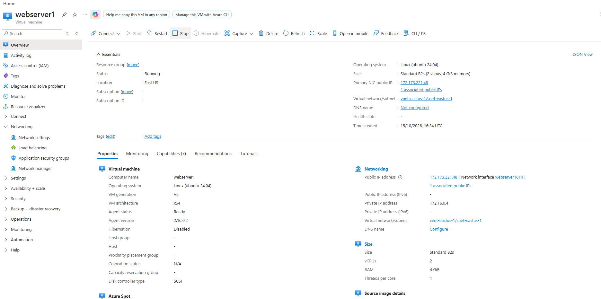

*Inspecting properties and public/private IP addresses for webserver1.*

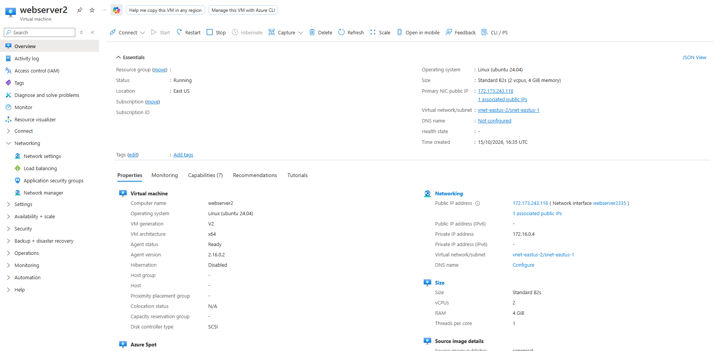

*Inspecting properties and public/private IP addresses for webserver2.*

---

### Step 2: Install Docker Engine on Backend Nodes

Established SSH connections to `webserver1` and `webserver2` to install Docker Engine, verifying binary versions to ensure compatibility for container workloads.

* **Docker Engine Version:** `29.9.1`

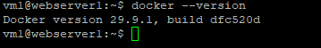

*Checking installed Docker Engine version on webserver1.*

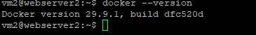

*Checking installed Docker Engine version on webserver2.*

---

### Step 3: Construct Web Application Artifacts and Dockerfiles

Created local application directories (`~/webapp`) on both backend nodes, writing custom `index.html` static landing pages and configuring `Dockerfile` builds based on `nginx:alpine`.

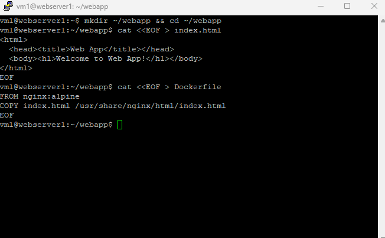

*Creating index.html and Dockerfile application manifests on webserver1.*

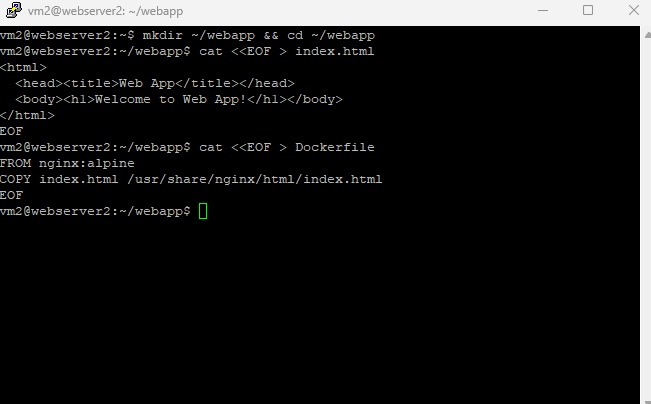

*Creating index.html and Dockerfile application manifests on webserver2.*

---

### Step 4: Build and Execute Web Application Containers

Built container images (`webapp:latest`) and launched detached container instances (`webapp-container`) exposing HTTP port 80 on both backend web server nodes.

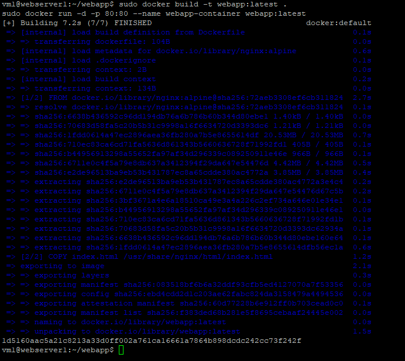

*Building image and starting webapp-container on webserver1.*

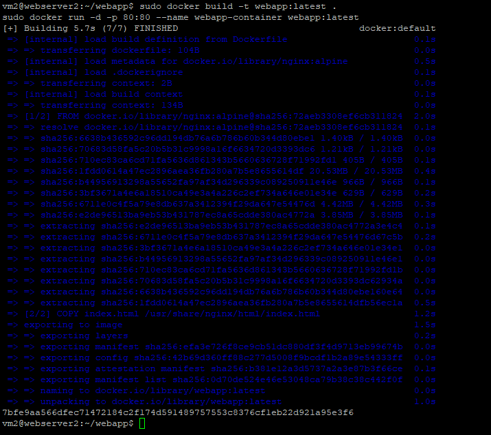

*Building image and starting webapp-container on webserver2.*

---

### Step 5: Verify Active Docker Containers

Executed verification checks on both nodes to ensure that the `webapp-container` instances were actively running and listening on port 80.

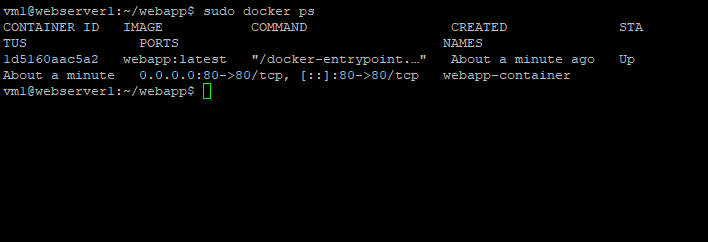

*Confirming container status and port mappings on webserver1.*

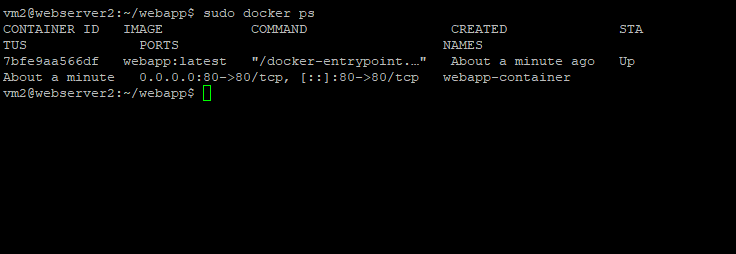

*Confirming container status and port mappings on webserver2.*

---

### Step 6: Install and Configure Nginx Reverse Proxy Load Balancer

Installed Nginx on the dedicated `loadbalancer` VM and configured `/etc/nginx/sites-available/default` with an `upstream` backend pool pointing to the backend web server private IP addresses.

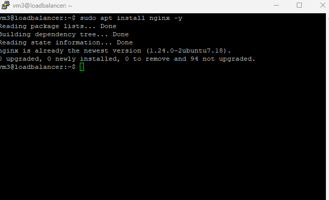

*Installing Nginx package on the loadbalancer VM.*

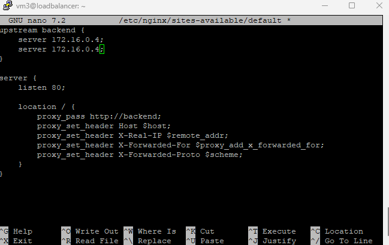

*Configuring upstream backend pool and proxy_pass directive in default site configuration.*

---

### Step 7: Test and Restart Nginx Service

Validated the syntax of the modified Nginx configuration file using syntax verification tools and restarted the system service to apply changes.

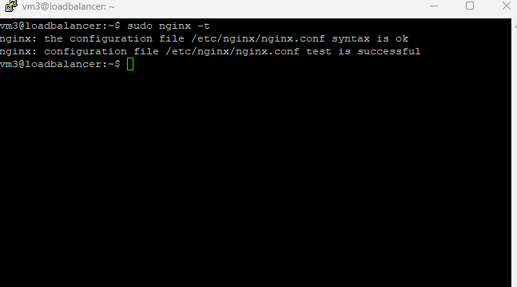

*Testing Nginx configuration syntax to ensure zero errors.*

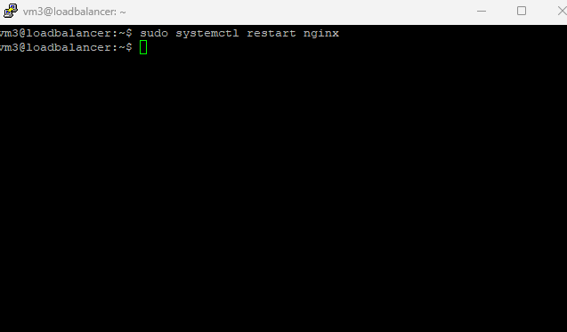

*Restarting systemctl Nginx daemon on loadbalancer node.*

---

### Step 8: Validate End-to-End Application Traffic Routing

Accessed the public IP address of the Nginx load balancer (`http://20.25.70.223`) via a web browser to verify successful reverse proxying and traffic delivery from the containerized backend web applications.

* **Load Balancer Public Endpoint:** `http://20.25.70.223`
* **Response Content:** `Welcome to Web App!`

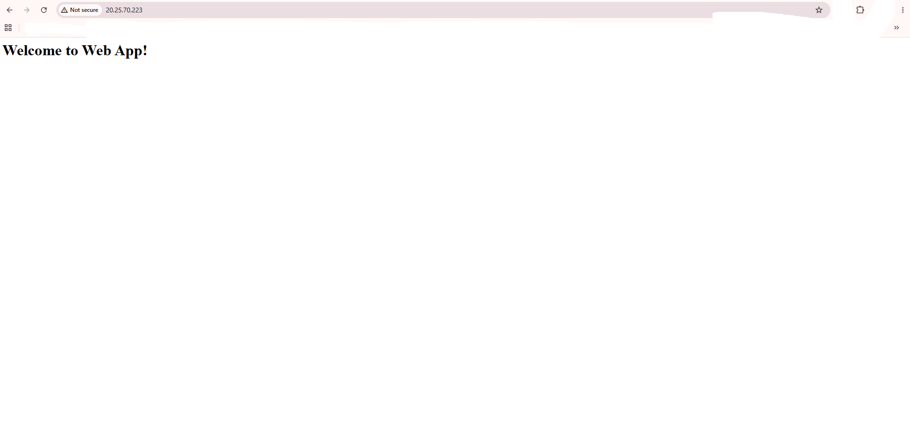

*Browser validation displaying the web application served through the Nginx reverse proxy load balancer.*
